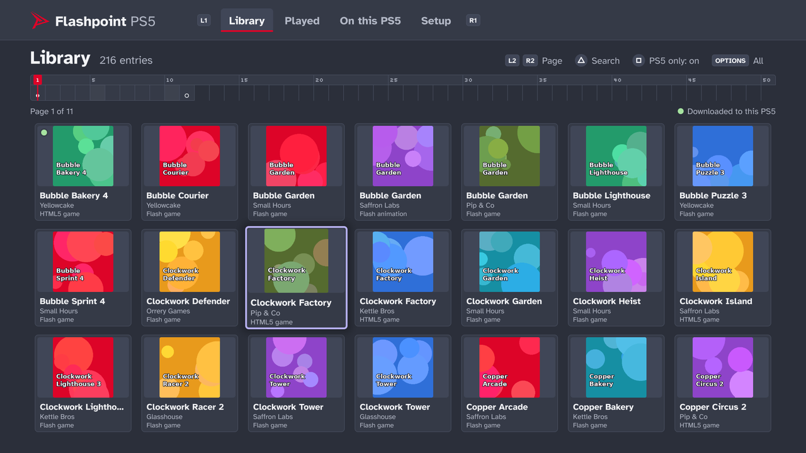
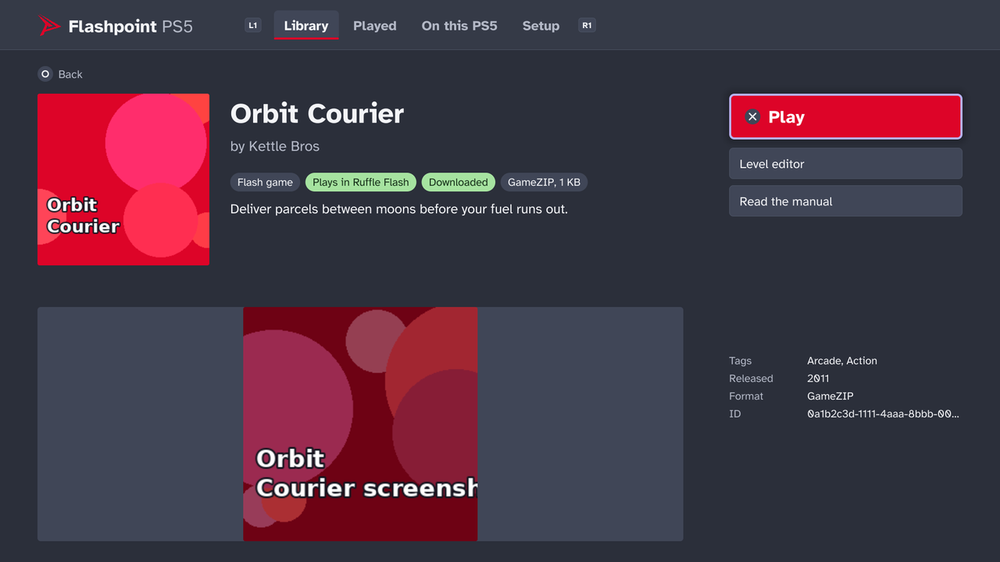
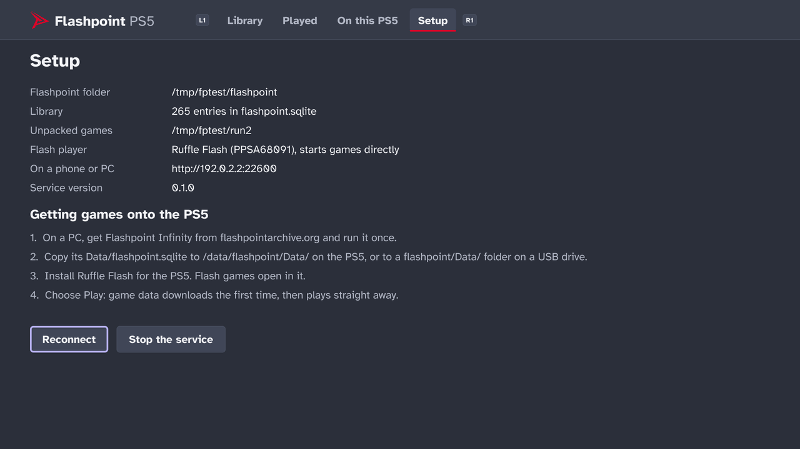

# Flashpoint PS5

A PS5 homebrew app (PPSA72386) for browsing and playing a
[Flashpoint Archive](https://flashpointarchive.org/) library on the TV with a
controller. It combines the [Flashpoint Launcher](https://github.com/FlashpointProject/launcher)
(reading Flashpoint's database and downloading game data when you play) with the
[Flashpoint Database](https://github.com/FlashpointProject/flashpoint-database)'s
search and entry pages. Flash games play natively in
[Ruffle Flash PS5](https://github.com/ZiZc3/Ruffle-Flash-PS5).

This is an unofficial port. It is not made or endorsed by Flashpoint Archive.

> **Status:** it builds into a signed app folder, and the whole app runs on a PC against
> the PC build of its service (pictures below). **It has not been run on a real PS5 yet,**
> so the first hardware runs may need fixes. Please open an issue with
> `/data/fpps5/fpps5.log` if something goes wrong.



## What you need

- A PS5 that runs homebrew apps, with an **ELF loader on port 9021** (etaHEN's,
  or kstuff with elfldr). The app's background service is a payload, and the app
  sends it to that loader the first time you open it.
- A **Flashpoint library**. Copy `Data/flashpoint.sqlite` from
  [Flashpoint Infinity](https://flashpointarchive.org/downloads) on a PC to
  `/data/flashpoint/Data/` on the PS5, or to `flashpoint/Data/` on a USB drive.
  Game data downloads from Flashpoint's servers the first time you play each game.
- **Ruffle Flash PS5** (PPSA68091) for Flash games.

## Install

1. Unzip `PPSA72386.zip` from the [latest release](https://github.com/Richie133/flashpointps5/releases/latest)
   and copy the `PPSA72386` folder to `/data/homebrew/` on the console (FTP). If
   you use a homebrew store, install it from there instead.
2. Open **Flashpoint PS5**. If the service isn't running yet, the app starts it.
   If nothing listens on port 9021, the app asks you to start your ELF loader
   and press **Cross** to try again.

## Controls

| Button | Library | Entry page |
|---|---|---|
| **L1 / R1** | Switch between Library, Played, On this PS5 and Setup | |
| **D-pad / left stick** | Move between games; going past the top or bottom row turns the page | Choose Play or an additional app |
| **L2 / R2** | Previous or next page (hold to scrub) | |
| **Cross** | Open the game's page | Play |
| **Triangle** | Search (system keyboard) | |
| **Square** | Show only games that play on the PS5, or everything | |
| **Options** | All, games only, or animations only | |
| **Circle** | Clear the search | Back |

Each page holds 21 entries. The strip above the grid works like a Flash
timeline: one frame per page, with the red playhead on the page you're viewing.



## What plays

| Platform | On the PS5 | How |
|---|---|---|
| Flash | Yes | Downloaded, unpacked, then opened in Ruffle Flash PS5 |
| HTML5 | Partly | Opens in the PS5 web browser through the service's game server. That browser has no WebGL or Web Audio, so some games show nothing or have no sound |
| Shockwave, Unity, Java, Silverlight, … | No | There's no PS5 player for them yet; the entry page says so |

With the Ruffle Flash PS5 patch in [`payload/ruffle-ps5/`](payload/ruffle-ps5/),
games start straight away. Without it, the service copies each game into
Ruffle's own library (`/data/ruffle/games/`) and opens the app, and you pick
the game there.

## How it works

```
Flashpoint PS5 app (PPSA72386)            flashpoint-ps5.elf (background service)
┌───────────────────────────────┐  HTTP   ┌─────────────────────────────────────────┐
│ native UI: OpenGL, controller │ ──────► │ :22600  JSON API (db-api compatible)     │
│ system keyboard and browser   │ 127.0.  │ :22500  Flashpoint-style game server     │
└───────────────┬───────────────┘ 0.1     │ SQLite  Data/flashpoint.sqlite           │
                │ first start: sends the  │ GameZIPs, logos, Legacy files on demand  │
                └── ELF to the loader on  └────────────────┬────────────────────────┘
                    port 9021                              │ unpack, then launch
                                                           ▼
                                            Ruffle Flash PS5 (PPSA68091)
```

An app's sandbox can't see `/data` or USB drives, so the app does none of the
file work itself. The service runs outside the sandbox: it reads the
Flashpoint folder, downloads game data, and hands games to Ruffle. The app asks
it for everything over HTTP on `127.0.0.1:22600`. The service is the payload
in [`payload/`](payload/), and it ships inside the app as
`assets/payload/flashpoint-ps5.elf`.

The same service also serves a web version of the interface: open
`http://<ps5-ip>:22600` on a phone or PC on the same network to browse the
PS5's library there. The Setup screen shows the address.



*The pictures come from the PC build with a small invented test library.*

## Building

On Linux or WSL with clang-18, lld, Python 3 and ninja:

```sh
make            # dist/PPSA72386/ and dist/PPSA72386.zip
make help       # everything else
```

The first build downloads the pinned [PS5 Payload SDK](https://github.com/ps5-payload-dev/sdk)
and [ps5-opengl](https://github.com/darkxex/ps5-opengl) into `.deps/` and
checks their checksums. `make` builds the service payload first and copies it
into the app's assets.

To see the app on a PC:

```sh
make payload-pc
payload/build/pc/fpps5 --root /path/to/Flashpoint --no-browser &
make host-snapshots     # PNGs of every screen in build/snapshots
```

To release a new version, raise `contentVersion` in `sce_sys/param.json`, push,
then run the **Build** workflow on GitHub (Actions → Build → Run workflow) with
**Publish a release** ticked. It builds the app and publishes the release
`v<version>` with `PPSA72386.zip` attached.

| Folder | What it is |
|---|---|
| `src/fp/` | The app: screens (`app.cpp`), service client (`backend.cpp`), image cache |
| `src/gfx/`, `src/ui/`, `src/core/`, `src/platform/` | The rendering and input kit from ps5-homebrew-ui |
| `payload/` | The background service (C): API, SQLite library, downloads, game server, Ruffle hand-off, and the web UI |
| `host/` | PC stand-ins and the snapshot tool |
| `tooling/`, `tools/`, `runtime/` | The native app toolchain from ps5-native-app-boilerplate |

## Credits and licence

Flashpoint PS5 is licensed under the GNU GPL v3 or later (see [LICENSE](LICENSE)).
It builds on:

- [Flashpoint Launcher](https://github.com/FlashpointProject/launcher) and
  [Flashpoint Database](https://github.com/FlashpointProject/flashpoint-database),
  both MIT ([licenses/](licenses/)), for how the library, downloads, game server
  and search work;
- [ps5-native-app-boilerplate](https://github.com/blackbearreloaded/ps5-native-app-boilerplate)
  and [ps5-homebrew-ui](https://github.com/blackbearreloaded/ps5-homebrew-ui) by
  BlackBearReloaded (GPL-3.0-or-later): the native app toolchain, runtime and UI kit;
- [PayLoader](https://github.com/Marice/ps5-payloader) by Marice (GPL-3.0-or-later):
  the loopback HTTP client, JSON reader and worker thread, and the idea of an app that
  brings its own payload;
- [offact](https://github.com/ps5-payload-dev/offact) (GPL-3.0) for how to use the system keyboard;
- [Ruffle](https://ruffle.rs/) and [Ruffle Flash PS5](https://github.com/ZiZc3/Ruffle-Flash-PS5) for playing Flash;
- the [PS5 Payload SDK](https://github.com/ps5-payload-dev/sdk) and
  [ps5-opengl](https://github.com/darkxex/ps5-opengl).

Third-party code and fonts are listed in [THIRD_PARTY_NOTICES.md](THIRD_PARTY_NOTICES.md).
