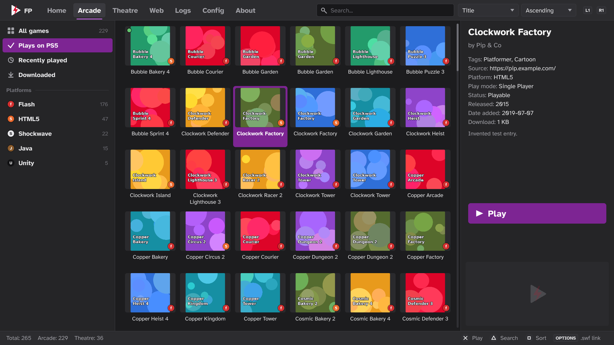
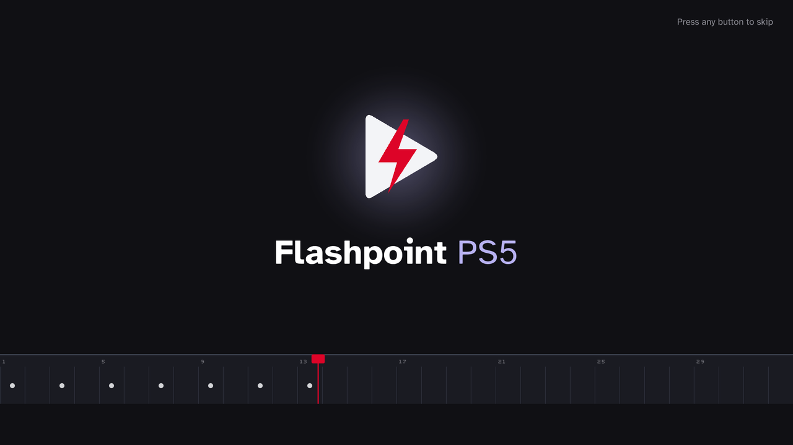
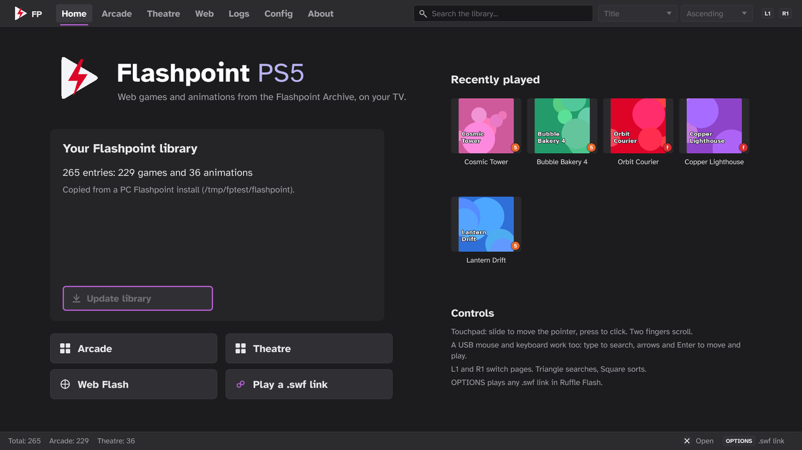
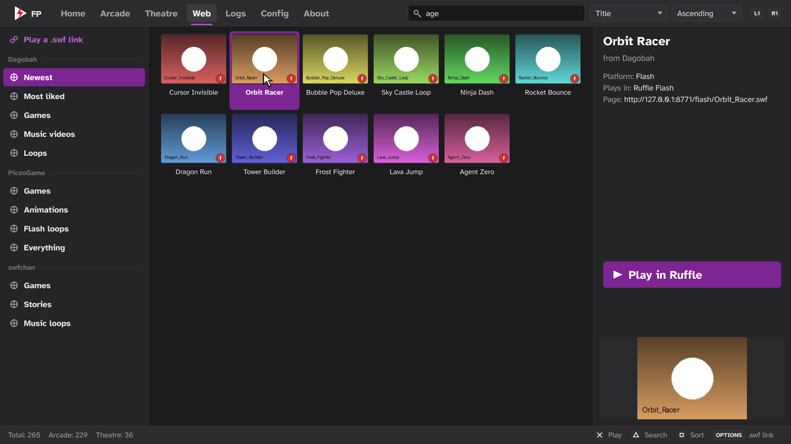
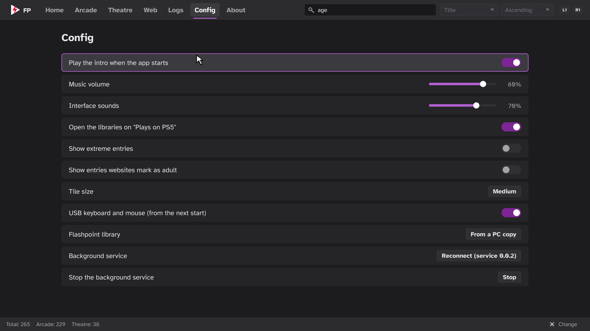

# Flashpoint PS5

A PS5 homebrew app (PPSA72386) for browsing and playing the
[Flashpoint Archive](https://flashpointarchive.org/) on the TV. It is laid out
like the [Flashpoint Launcher](https://github.com/FlashpointProject/launcher):
Arcade and Theatre, search, a filter sidebar, a tile grid and a details panel.
The library downloads itself from Flashpoint's servers, so no PC is needed.
Flash plays in [Ruffle Flash PS5](https://github.com/ZiZc3/Ruffle-Flash-PS5),
including Flash from Dagobah, PiczoGame, swfchan or any `.swf` link.

This is an unofficial port. It is not made or endorsed by Flashpoint Archive.

> **Status: alpha.** It builds into a signed app folder, and the whole app runs on a PC
> against the PC build of its service (pictures below). **It has not been run on a real
> PS5 yet,** so the first hardware runs may need fixes. The Logs page shows the
> service's log (`/data/fpps5/fpps5.log`); please open an issue with it if something
> goes wrong.



## What you need

- A PS5 that runs homebrew apps, with an **ELF loader on port 9021** (etaHEN's,
  or kstuff with elfldr). The app's background service is a payload, and the app
  sends it to that loader the first time you open it.
- An internet connection: the list of games and animations comes from
  Flashpoint's metadata server on first start (as the Flashpoint Launcher does
  it), and each game's files download the first time you play it.
- **Ruffle Flash PS5** (PPSA68091) for Flash.

A library copied from a PC still works: put Flashpoint Infinity's
`Data/flashpoint.sqlite` in `/data/flashpoint/Data/` or a USB drive's
`flashpoint/Data/`, and the app uses it instead of downloading one.

## Install

1. Unzip `PPSA72386.zip` from the [latest release](https://github.com/Richie133/flashpointps5/releases)
   and copy the `PPSA72386` folder to `/data/homebrew/` on the console (FTP). If
   you use a homebrew store, install it from there instead.
2. Open **Flashpoint PS5**. The intro plays while the background service starts.
   The first time, the library downloads (Home shows the progress); Arcade and
   Theatre fill in as it arrives.





## Using it

| | Controller | Touchpad, mouse, keyboard |
|---|---|---|
| Switch pages (Home, Arcade, Theatre, Web, Logs, Config, About) | **L1 / R1** | Click the menu |
| Move | **D-pad / left stick**; **L2 / R2** jump a screen; right stick scrolls | Pointer; wheel or two fingers scroll; arrow keys, Page Up / Down, Tab |
| Play the selected entry | **Cross** | Double-click the tile, or click **Play**; Enter |
| Search | **Triangle** (system keyboard) | Just type |
| Sort (title, date added, developer, release date, random) | **Square** | Click the sort menus |
| Filters (all, plays on PS5, recently played, downloaded, platforms) | Left from the grid, then **Cross** | Click the sidebar |
| Play any .swf link | **Options** | Web, then "Play a .swf link" |
| Back, clear the search | **Circle** | Esc, Backspace |

The touchpad works like a laptop's: slide one finger to move the pointer,
press it to click, and slide two fingers to scroll. A USB mouse and keyboard
work too (Config can turn them off).

### Web

The Web page lists Flash from **Dagobah** (newest, most liked, games, music
videos, loops), **PiczoGame** (games, animations, Flash loops) and **swfchan**
(its clean games, stories and music-loop categories), read from those sites'
own pages when you open them. Search works on Dagobah and PiczoGame. Choosing
**Play in Ruffle** finds the `.swf` on the entry's page, downloads it and opens
it in Ruffle Flash. Entries a site marks as adult are hidden unless you turn
them on in Config.

**Play a .swf link** takes any address: a `.swf` file, or a page with one.



### Config

Intro on or off, music and interface sound volume, tile size, showing
extreme or adult entries, USB keyboard and mouse, updating the library, and
reconnecting or stopping the background service.

## What plays

| Platform | On the PS5 | How |
|---|---|---|
| Flash | Yes | Downloaded, unpacked, then opened in Ruffle Flash PS5 |
| HTML5 | Partly | Opens in the PS5 web browser through the service's game server. That browser has no WebGL or Web Audio, so some games show nothing or have no sound |
| Shockwave, Unity, Java, Silverlight, … | No | There's no PS5 player for them yet; the entry page says so |

With the Ruffle Flash PS5 patch in [`payload/ruffle-ps5/`](payload/ruffle-ps5/),
games start straight away. Without it, the service copies each game into
Ruffle's own library (`/data/ruffle/games/`) and opens the app, and you pick
the game there.

## How it works

```
Flashpoint PS5 app (PPSA72386)            flashpoint-ps5.elf (background service)
┌───────────────────────────────┐  HTTP   ┌─────────────────────────────────────────┐
│ native UI: OpenGL, controller │ ──────► │ :22600  JSON API (db-api compatible)    │
│ touchpad, USB mouse/keyboard  │ 127.0.  │ :22500  Flashpoint-style game server    │
│ intro music, interface sounds │ 0.1     │ library: built from Flashpoint's        │
└───────────────┬───────────────┘         │ metadata server (or a PC copy)          │
                │ first start: sends the  │ web sources and .swf links              │
                └── ELF to the loader on  │ GameZIPs, logos, Legacy files on demand │
                    port 9021             └──────────────┬──────────────────────────┘
                                                         │ unpack, then launch
                                                         ▼
                                            Ruffle Flash PS5 (PPSA68091)
```

An app's sandbox can't see `/data` or USB drives, so the app does none of the
file work itself. The service runs outside the sandbox: it reads the
Flashpoint folder, downloads game data, and hands games to Ruffle. The app asks
it for everything over HTTP on `127.0.0.1:22600`. The service is the payload
in [`payload/`](payload/), and it ships inside the app as
`assets/payload/flashpoint-ps5.elf`.

The same service also serves a web version of the interface: open
`http://<ps5-ip>:22600` on a phone or PC on the same network to browse the
PS5's library there. The About page shows the address.



*The pictures come from the PC build with a small invented test library and sample web pages.*

## Building

On Linux or WSL with clang-18, lld, Python 3 and ninja:

```sh
make            # dist/PPSA72386/ and dist/PPSA72386.zip
make help       # everything else
```

The first build downloads the pinned [PS5 Payload SDK](https://github.com/ps5-payload-dev/sdk)
and [ps5-opengl](https://github.com/darkxex/ps5-opengl) into `.deps/` and
checks their checksums. `make` builds the service payload first and copies it
into the app's assets.

To see the app on a PC:

```sh
make payload-pc
payload/build/pc/fpps5 --root /path/to/Flashpoint --no-browser &
make host-snapshots     # PNGs of every screen in build/snapshots
```

To release a new version, raise `contentVersion` in `sce_sys/param.json` (consoles
use it to spot updates), push, then publish a release on GitHub with any tag. The
**Build** workflow attaches `PPSA72386.zip` to it a few minutes later and adds the
zip's sha256 under your notes. To redo a release's zip, run the workflow
(Actions → Build → Run workflow) with that release's tag.

| Folder | What it is |
|---|---|
| `src/fp/` | The app: screens (`app.cpp`), service client (`backend.cpp`), image cache |
| `src/gfx/`, `src/ui/`, `src/core/`, `src/platform/` | The rendering and input kit from ps5-homebrew-ui |
| `payload/` | The background service (C): API, SQLite library, downloads, game server, Ruffle hand-off, and the web UI |
| `host/` | PC stand-ins and the snapshot tool |
| `tooling/`, `tools/`, `runtime/` | The native app toolchain from ps5-native-app-boilerplate |

## Credits and licence

Flashpoint PS5 is licensed under the GNU GPL v3 or later (see [LICENSE](LICENSE)).
It builds on:

- [Flashpoint Launcher](https://github.com/FlashpointProject/launcher) and
  [Flashpoint Database](https://github.com/FlashpointProject/flashpoint-database),
  both MIT ([licenses/](licenses/)), for how the library, downloads, game server
  and search work;
- [ps5-native-app-boilerplate](https://github.com/blackbearreloaded/ps5-native-app-boilerplate)
  and [ps5-homebrew-ui](https://github.com/blackbearreloaded/ps5-homebrew-ui) by
  BlackBearReloaded (GPL-3.0-or-later): the native app toolchain, runtime and UI kit;
- [PayLoader](https://github.com/Marice/ps5-payloader) by Marice (GPL-3.0-or-later):
  the loopback HTTP client, JSON reader and worker thread, and the idea of an app that
  brings its own payload;
- [offact](https://github.com/ps5-payload-dev/offact) (GPL-3.0) for how to use the system keyboard;
- [Ruffle](https://ruffle.rs/) and [Ruffle Flash PS5](https://github.com/ZiZc3/Ruffle-Flash-PS5) for playing Flash;
- the [PS5 Payload SDK](https://github.com/ps5-payload-dev/sdk) and
  [ps5-opengl](https://github.com/darkxex/ps5-opengl).

Third-party code and fonts are listed in [THIRD_PARTY_NOTICES.md](THIRD_PARTY_NOTICES.md).
